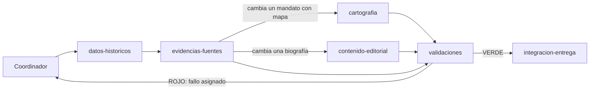

# V5.28 · Revisión de código, estructura y subagentes

Revisión completa del repositorio en tres fases sobre `main` en `d65f8ca`, después de la V5.27:

1. código innecesario: qué se ha eliminado y qué conviene simplificar;
2. estructura de carpetas propuesta y plan de migración;
3. arquitectura de subagentes especializados para el flujo de trabajo del proyecto.

La versión no cambia datos históricos, cartografía ni textos visibles. La regresión V5 (datos, mosaicos anuales y fichas públicas) termina con 0 diferencias.

## Método

- **Grafo de Graphify** del commit `d65f8ca`: 2.442 nodos, 6.629 aristas y 122 comunidades. Antes de borrar un símbolo se comprobó que tenía 0 referencias y 0 llamadas (`graphify_references`, `graphify_callers`). `graphify_file_neighbors` y `graphify_rank_files` sirvieron para medir el alcance de los módulos centrales. Por ejemplo, `src/Territorios.jsx` tiene 42 archivos vecinos.
- **Recorrido del AST** de los 393 módulos JavaScript con el parser Oxc que ya incluye Vite (`rolldown/utils`):
  - exports que ningún otro archivo menciona;
  - identificadores declarados una sola vez;
  - cuerpos de función idénticos entre archivos;
  - archivos de `src/` que la aplicación no alcanza desde `src/main.jsx`, `src/public/ssg-entry.jsx` o el mapa completo.
- **`git grep`** para lo que no se ve en el grafo:
  - importaciones dinámicas con plantilla, como los pasos de `scripts/research/authority-review/run.mjs`;
  - rutas dentro de HTML;
  - lecturas con `readFileSync` y `new URL(…, import.meta.url)`;
  - archivos servidos desde `public/`;
  - nombres con tilde o eñe (`idsDeGobiernoEnAño`), que las búsquedas con `\w` no encuentran.

## Fase 1 · Código innecesario

### Eliminado en esta versión

| Elemento | Motivo | Verificación |
| --- | --- | --- |
| Laboratorio de renderizado: `src/lab/` (4 archivos), su ruta en `App.jsx`, dos reescrituras de `vercel.json` y `tests/renderer-lab-v36.test.mjs` | Experimento de la V3.6 (HTML + SVG frente a Canvas 2D) cerrado sin migración. La página no tenía enlaces y no estaba en el índice | Solo lo importaba su test. Commit propio, revertible con `git revert` |
| `src/components/BioDiscovery.css` | Su `import` se quitó en septiembre; las reglas `.bio-discover` viven en `App.css` | Ningún archivo lo importa |
| `src/evidence/entities.js` (`buildEntityIndex`, `entityId`, `ENTITY_KINDS`) | Ni la aplicación ni los scripts lo usaban; solo un test | El test conserva sus asertos de cobertura |
| `src/public/EnglishLanding.jsx` | Alias de una línea de `EnglishPage.jsx` | `App.jsx` y `Explorer.jsx` importan la página directamente |
| Exports sin importadores: `Collapsible` (`ExplorerPrimitives.jsx`), `RAMA_A_PRINCIPAL` y `sonAmantes` (`model.js`), `SUPPORTED_LOCALES`, `LOCALES` y una copia de `ROUTE_SEGMENTS` (`i18n.jsx`) | Código muerto. `model.js` tiene su propio `ROUTE_SEGMENTS` | 0 referencias en el grafo y en `git grep` |
| `IMPERIAL_FRAME_SOURCES` (`imperialFrame.js`) | Export sin uso | Las cuatro URL pasan a un comentario para conservar la procedencia |
| Re-exportaciones sin consumidores: `FILTER_REGIONS` en `atlasFilters.js` y la geometría en `treeLayout.js` | Nadie importaba esos nombres a través de esos archivos | Comprobado import a import |
| Modelo de vista del Atlas: 67 de sus 221 campos | `Explorer.jsx` los pasaba y ni `ExplorerView.jsx` ni `AtlasTimeline.jsx` los leían | Recuento de usos en las dos vistas |
| Paneles redimensionables (`ajustarAnchoPanel`, `restablecerAnchoPanel`, `comenzarResizeLateral`, `comenzarResizeArbolMapa`, los estados `panelWidths` y `treeMapSplit`, sus refs y `limitarNumero`) | La V5.20 quitó los tiradores de la interfaz y la lógica quedó sin uso | Sin lectores tras el punto anterior |
| `alternarVista`, `hayFiltros` y `totalEventosTimeline` | Mismo caso | Sin lectores |
| Variables locales sin uso: `TREE_COLUMN_STEP` (generador), `charlesNetherlands` (`reviewRecords.js`), `gobiernosDe`, `byId` y `ent` (revisión bibliográfica), dos constantes en tests | Declaradas y nunca leídas | Identificador con una sola aparición en su archivo |
| `import React` por defecto en 44 archivos | El JSX usa el runtime automático (Vite 8/Oxc y `tests/jsx-loader.mjs`) | Se conserva donde se usa `React.Suspense`, `React.memo`, etc. |
| Dependencia `@vitejs/plugin-react` | `vite.config.js` nunca la ha cargado | Build y tests sin ella |

En total, la fase 1 retira 8 archivos y 790 líneas, con 93 añadidas: unas 700 líneas netas menos.

### Propuestas de simplificación no aplicadas

Quedan fuera de esta versión porque cambian el comportamiento interno, necesitan una revisión visual o chocan con trabajo en curso. El orden es de mayor a menor beneficio.

| # | Elemento | Problema | Propuesta | Riesgo |
| --- | --- | --- | --- | --- |
| S1 | `scripts/generate/generate-tree-base.mjs` frente a `src/explorer/treeLayout.js` y `model.js` | Unas 500 líneas copiadas literalmente: `buildRows`, `createPartnerUnitBlueprint`, `orderPartnerComponent`, `orderPathIds`, `pavaNonDecreasing`, `listaConyuges`, `listaParejas`, `mediana`… `computeGenerations` y `computeTreeLayout` ya divergen entre las dos copias. El generador no puede importar `treeLayout.js` porque este depende de `model.js`, que importa `.jsx` | Paso M5 del plan: renombrar los `.jsx` sin JSX y extraer un módulo puro de relaciones parametrizado por `byId`, que el generador importe | Medio: `tree-layout-v3.test.mjs` y la regresión lo cubren |
| S2 | `src/Explorer.jsx` (1.633 líneas) y `src/explorer/ExplorerView.jsx` (1.150) | Componente con 52 `useState` y un modelo de vista de 154 campos | Hooks por dominio (`useAtlasFilters`, `useAtlasTimeline`, `useAtlasStory`, `useTreeNavigation`) y subcomponentes de vista (cabecera, filtros, árbol, ficha) | Medio-alto: necesita verificación visual |
| S3 | `.jsx` sin JSX: `personas.jsx`, `historiaData.jsx`, `Territorios.jsx` e `i18n.jsx` | Obligan al truco de data-URL del generador (`importJsxData`, duplicado en dos generadores). Impiden que los generadores compartan módulos con la aplicación | Renombrar a `.js`. `i18n` necesita `import.meta.env?.` porque el cargador de tests solo sustituye `import.meta.env` en `.jsx` | Bajo en código. Coordinar ramas abiertas que toquen `personas.jsx` |
| S4 | CSS por versión: `src/explorer/v39.css`, `v40.css`, `src/styles/v518.css`–`v521.css`, y `App.css` (116 KB) | El nombre dice cuándo se escribió, no qué estiliza. `App.css` conserva reglas de funciones retiradas, como `.workspace-resize-handle`, `--workspace-resizer-width` y `body.atlas-is-resizing` | Repartir por componente y retirar las reglas sin elementos | Medio: el orden de la cascada cambia; necesita capturas antes y después |
| S5 | `src/evidence/corridorReviewData.js` | Archivo versionado que `generate-tree-base.mjs` reescribe en cada build | Generarlo en `src/generated/` o dejar de versionarlo | Bajo-medio |
| S6 | `scripts/research/authority-review/` | Pasos `match1`, `match4` y `match5` con nombres poco descriptivos; `getJSON`, `year` e `ids` copiados en tres pasos | Nombres por función (`wikipedia-titulos`, `sparql-nombres`, `wikidata-busqueda`) y un `http.mjs` común | Bajo; necesita red para comprobarlo |
| S7 | Unos 55 exports que solo se usan dentro de su archivo (esquemas de `data-contract.mjs`, constantes de `treeLayout.js`, `dinastleEngine.js`…) | Superficie pública mayor de la necesaria | Quitar la palabra `export` cuando no la necesite un test | Muy bajo; poco beneficio |
| S8 | Funciones homónimas con semántica distinta: `governmentKey` (`data-contract.mjs` / `europeTimeline.js`), `conyugesDe` (`personAccessors.js` / `desafioEngine.js`, que incluye inversos), `localeDesdePath` (`routing.js` / `model.js`), hash FNV en `learning.js` y `dinastleEngine.js` | Confunden al leer y al buscar | Renombrar o compartir una única implementación | Bajo |
| S9 | `src/MapChart_Map.svg` (6,4 MB) | Vive en `src/` pero la aplicación no lo empaqueta. Solo lo leen tests, Python, el laboratorio y `audit-security` | Moverlo con los datos cartográficos (paso M7) | Bajo; 16 archivos lo citan |
| S10 | `public/EADE.png` (2000×2000) | Ninguna referencia en el repositorio; se sirve en `/EADE.png` | Confirmar con el propietario si se usa fuera (perfil, redes) antes de borrarlo | Desconocido |
| S11 | `sharp` en `devDependencies` | Ningún script versionado lo usa. La V5.18 lo empleó a mano para las variantes WebP | Versionar el script de variantes o retirar la dependencia | Bajo |

## Fase 2 · Estructura propuesta

### Diagnóstico

- **Producción dependía de `prototypes/`.** `src/data/europePanorama.js`, la regresión V5, seis auditorías y 19 tests importaban `prototypes/euv-locations/atlas-mosaic.js`, que el catálogo clasificaba como «laboratorio». Corregido en esta versión (paso M1).
- **`src/data/` mezcla responsabilidades.** Reúne 53 módulos: datos fuente (`territorios.js`), cartografía (rutas, identidades, mosaicos), presentación (`governmentPresentation.js`) y lógica que solo usaban las auditorías. Esto último se ha trasladado en esta versión (paso M2).
- **Raíz de `src/` sin criterio.** Datos de 1 MB (`personas.jsx`, `historiaData.jsx`) conviven con componentes (`MapaEuropa.jsx`, `Explorer.jsx`) y utilidades (`mapViewport.js`, `monitoring.js`).
- **Nombres por versión en lugar de por tema.** Ocurre en tests (`*-v213.test.mjs`), contenido (`personas/minibiografias-v524.js`) y CSS.
- **`docs/` mezcla dos tipos de documento.** Unos 80 informes `V*.md` en la raíz conviven con las guías vigentes.

### Estructura objetivo

```
src/
  app/            Arranque, enrutado y configuración: main.jsx, App.jsx, routing.js, siteConfig.js, i18n.js, monitoring.js
  data/           Base de datos histórica editable: personas.js, territorios.js, historias.js, imagenesPersonas.js
  content/        Contenido editorial (ya existe): biografías, dinastías, territorios, sucesiones, coronas, fuentes
  evidence/       Revisiones por afirmación (datos) y claims.js / reviewRecords.js (lógica)
  domain/         Lógica pura sin React ni DOM:
    genealogy/    model.js, relationshipGraph.js, personAccessors.js, dynastyModel.js, treeLayout.js, treeGeometry.js
    government/   lógica de Territorios.js, governmentPresentation.js, crowns.js, sucesion.js, successionHistory.js
    time/         europeYear.js, europeTimeline.js, timelineUtils.js, documentaryDates.js
  cartography/    Rutas (*Routes.js + *RouteData.json), mosaico (atlasMosaic.js, locationMosaic.js), locationMapPilot.js,
                  territorialIdentity.js, politicalMapIndex.js, mapAuthorities.js, imperialFrame.js, colores
  features/       Interfaz por función: atlas/ (Explorer + explorer/), public/, stories/, desafio/, connections/,
                  english/, embed/, settings/
  ui/             Primitivas compartidas (ui/ + components/)
  styles/         Tema y capas globales con nombres por propósito
  generated/      Salida de scripts/generate (ignorada en Git)
data/
  cartography/    Fuentes, revisiones e inventarios aceptados (hoy prototypes/euv-locations/*.json) y MapChart_Map.svg
labs/
  cartography/    Visores de revisión (hoy prototypes/euv-locations/*.html y capturas)
scripts/
  generate/       Generadores del build
  audits/         Auditorías; audits/lib/ con su lógica compartida
  cartography/    Herramientas Node y Python de geometría
  research/       Revisiones bibliográficas con red
  schema/  lib/   Contrato de datos, regresión y utilidades
tests/            Por dominio (genealogy/, cartography/, ui/, content/, build/), fixtures/ y baselines/
docs/             Guías vigentes en la raíz; versiones/ (V*.md), reports/, archive/
.claude/agents/   Subagentes del proyecto (fase 3)
```

Propósito de cada capa:

- `src/domain` y `src/cartography` no importan React. Son lo que pueden compartir los generadores, las auditorías y la interfaz, y eso elimina copias como S1.
- `src/features/*` agrupa por funcionalidad lo que hoy está repartido entre `src/`, `src/explorer` y `src/public`. Cada carpeta tiene su CSS al lado.
- `data/cartography` y `labs/cartography` separan los datos aceptados de los visores, sin la palabra «prototipo», que `scripts/README.md` ya tiene que desmentir.

### Cómo reorganizar los módulos existentes

| Hoy | Destino | Nota |
| --- | --- | --- |
| `src/personas.jsx`, `src/historiaData.jsx` | `src/data/personas.js`, `src/data/historias.js` | Requiere S3. Elimina `importJsxData` de los generadores |
| `src/Territorios.jsx` | `src/cartography/kingdoms.js` (IDs, versiones y colores) + `src/domain/government/reigns.js` (`listaReinados`, `reinadosActivos`…) | Separa el mapa de la lógica de gobierno |
| `src/explorer/model.js` | `src/domain/genealogy/` (relaciones, índices) + `src/app/` (rutas y slugs) | Es el módulo con más dependientes de la interfaz |
| `src/data/*Routes.js`, `*RouteData.json`, `*Territories.js`, `atlasMosaic.js`, `locationMosaic.js`, `locationMapPilot.js`, `territorialIdentity.js`, `politicalMapIndex.js`, `mapAuthorities.js`… | `src/cartography/` | Mismo nombre de archivo |
| `src/MapaEuropa.jsx`, `src/mapViewport.js` | `src/features/atlas/map/` | |
| `src/Explorer.jsx`, `src/explorer/*.jsx` | `src/features/atlas/` | Con S2, en hooks y subcomponentes |
| `src/components/*` | `src/ui/` o la funcionalidad que los usa | `CrownTimeline` y `HistoricalUnions` van a `features/atlas` |
| `prototypes/euv-locations/*.json`, `src/MapChart_Map.svg` | `data/cartography/` | `scripts/lib/project-paths.mjs` ya centraliza la ruta (`mapDataDirectory`) |
| `prototypes/euv-locations/*.html`, `*.png` | `labs/cartography/` | Actualizar `vite.config.js` y `vercel.json` (`/es/mapa-completo`) |
| `docs/V*.md` | `docs/versiones/` | Dejar en la raíz un índice y no romper los enlaces publicados en las Releases |

### Plan de migración por pasos

Cada paso es un commit o una PR que deja tests, build y regresión en verde. Los pasos marcados como aplicados están en esta versión.

| Paso | Cambio | Estado | Riesgo y verificación |
| --- | --- | --- | --- |
| M1 | `prototypes/euv-locations/atlas-mosaic.js` y `location-mosaic.js` → `src/data/atlasMosaic.js` y `locationMosaic.js`. Se actualizan 28 importadores, entre ellos el mapa completo, y el catálogo de artefactos | **Aplicado** | Bajo. Tests, `audit:artifacts`, regresión de mosaicos 1200–1800 |
| M2 | Lógica que solo usan las auditorías (`auditTerritorios`, `locationMapAudit`, `mapContinuityAudit`, `mapSpatialAudit`, `earlyPeopleInventory`, `locationResearchTargets`) → `scripts/audits/lib/` | **Aplicado** | Bajo. Ningún módulo de la aplicación los importaba |
| M3 | `src/desafio/desafioEngine.jsx` → `.js` (no contiene JSX) | **Aplicado** | Bajo. 3 importadores |
| M4 | La nota raíz `next updates` (sin extensión y con espacio) → `docs/archive/next-updates-v2.md` | **Aplicado** | Nulo |
| M5 | S3: `Territorios.jsx`, `historiaData.jsx`, `personas.jsx` e `i18n.jsx` → `.js`. Después, S1: el generador importa el diseño del árbol en lugar de copiarlo | Pendiente | Bajo-medio. Coordinar con ramas abiertas; la regresión pública compara las fichas |
| M6 | Crear `src/cartography/` y mover los módulos de mapa de `src/data/` con `git mv` y reescritura automática de rutas | Pendiente | Bajo. Unos 80 archivos importadores |
| M7 | `prototypes/euv-locations/` → `data/cartography/` + `labs/cartography/`: rutas Python (`project_paths.py`), `project-paths.mjs`, catálogo, CI (`git diff --exit-code`), documentación | Pendiente | Medio. Toca Python y la CI |
| M8 | `src/domain/` y `src/features/` por carpetas, con alias de importación (`resolve.alias` en Vite y en `tests/jsx-loader.mjs`) para evitar `../../..` | Pendiente | Medio. Una carpeta por PR |
| M9 | S2: dividir `Explorer.jsx` y `ExplorerView.jsx` | Pendiente | Medio-alto. Verificación visual |
| M10 | S4: CSS por componente | Pendiente | Medio. Capturas antes y después |
| M11 | `docs/V*.md` → `docs/versiones/` y tests por dominio | Pendiente | Bajo. Comprobar enlaces |

## Fase 3 · Arquitectura de subagentes

El flujo real del proyecto tiene seis tipos de trabajo, y cada uno con su contrato y sus auditorías:

- datos históricos;
- evidencias;
- cartografía;
- contenido editorial;
- interfaz;
- entrega con regresión.

Los subagentes siguen esas costuras. Las definiciones están en `.claude/agents/*.md`: el cuerpo de cada archivo es su prompt de sistema completo, y Claude Code las carga al abrir el repositorio.

### Agentes

| Agente | Rol | Escribe en | Comprobaciones propias |
| --- | --- | --- | --- |
| [`datos-historicos`](../.claude/agents/datos-historicos.md) | Base de datos: personas, fechas, parentescos, mandatos, territorios, sucesiones, coronas | `src/personas.jsx`, `src/data/territorios.js`, `src/content/sucesiones/`, `src/content/coronas/` | `audit:data-contract`, `audit-personas`, `audit-territorios`, sucesiones, coronas, dinastías |
| [`evidencias-fuentes`](../.claude/agents/evidencias-fuentes.md) | Fuentes y certeza de cada afirmación; revisión con fichas GND | `src/evidence/*.js`, `src/content/sources*.js`, `scripts/research/` | Tests de evidencias, contrato |
| [`cartografia`](../.claude/agents/cartografia.md) | Superficies anuales, rutas, identidades y colores; Python | `prototypes/euv-locations/`, `scripts/cartography/`, módulos de mapa de `src/data/`, `src/Territorios.jsx` | `audit:artifacts`, auditorías de continuidad y celdas, `cartography:check` |
| [`contenido-editorial`](../.claude/agents/contenido-editorial.md) | Biografías, historias, dinastías, territorios, retratos, edición inglesa | `src/content/` (salvo fuentes y sucesiones), `src/historiaData.jsx`, `public/personas-img/` | `npm run generate`, tests de contenido |
| [`interfaz`](../.claude/agents/interfaz.md) | React, CSS, accesibilidad, SSG e hidratación | Componentes `.jsx`, `.css`, `routing.js`, `index.html`, `vercel.json` | Tests de interfaz, verificación en el navegador, muestra SSG |
| [`validaciones`](../.claude/agents/validaciones.md) | Ejecuta contratos, auditorías, tests, build y regresión; emite el dictamen | Solo `.cache/` | Todas; asigna cada fallo a su responsable |
| [`calidad-codigo`](../.claude/agents/calidad-codigo.md) | Código muerto, duplicados, estilo y estructura; sin cambios de comportamiento | Cualquier ruta, coordinada con su propietario | Graphify + `git grep` antes de borrar; tests afectados |
| [`integracion-entrega`](../.claude/agents/integracion-entrega.md) | Versión, informe, base de regresión justificada, commits y PR | `package.json`, `docs/V*.md`, `docs/releases.md`, `tests/baselines/` (solo vía npm) | Exige un dictamen VERDE |

### Instrucciones clave de cada prompt

- **datos-historicos.** Conserva una persona por línea. No cambia un dato sin obra, URL y pasaje. Busca duplicados antes de crear. Los IDs son estables. Lee el contrato (`data-model.md`, `contributing-people.md`) al empezar.
- **evidencias-fuentes.** Usa solo las certezas `documented`, `approximate`, `disputed`, `inferred` y `pending`. Nunca inventa fuentes ni páginas. Prefiere obras de referencia específicas, y la fecha de Deutsche Biographie no cuenta como independiente de GND. Propone las correcciones al agente de datos en lugar de aplicarlas.
- **cartografia.** Una coincidencia espacial no prueba dominio. Regenera en `.cache/cartography/work` con `EADE_MAP_DATA_DIR` y cataloga cada archivo nuevo. Mide el alcance con Graphify antes de tocar módulos centrales. Describe año y celda de cada diferencia de regresión esperada.
- **contenido-editorial.** No añade hechos sin fuente. Fechas y títulos coinciden con `personas.jsx`; una discrepancia la corrige el agente de datos. Cada retrato lleva licencia y origen.
- **interfaz.** Runtime JSX automático. El primer render debe coincidir con el HTML prerenderizado. Mantiene `strictExecutionOrder`. El modelo de vista se cambia en los dos lados. Verifica en el navegador a 375 px y en ambos temas.
- **validaciones.** Ejecuta en orden contrato, seguridad, `audit:build`, tests y build. No edita nada y nunca escribe bases. Asigna cada fallo según la tabla de rutas.
- **calidad-codigo.** Confirma con el grafo y con `grep` (clases Unicode). Conoce los puntos ciegos: imports con plantilla, HTML, `readFileSync`, `public/`. Hace commits pequeños y revertibles.
- **integracion-entrega.** Sin dictamen VERDE no hay PR. La base de regresión solo cambia con un motivo que coincida con los informes. Aplica las convenciones de commit y de PR, y nunca hace `stash`, `reset` ni cambia de rama ajena.

### Protocolo de comunicación

1. **Coordinador.** La sesión principal recibe la petición y escribe la ficha `.cache/agentes/<tarea>/00-encargo.md`:
   - objetivo;
   - rutas permitidas;
   - criterio de hecho;
   - agentes y orden.

   `.cache/` está ignorado por Git.
2. **Informes de entrega.** Cada agente termina escribiendo `NN-<agente>.md` en esa carpeta, con el formato fijo de su prompt (estado, cambios con `archivo:línea`, fuentes, comandos con su resultado, a quién afecta y pendientes). Devuelve el mismo texto como respuesta. El siguiente agente lee la ficha y los informes anteriores, no la conversación.
3. **Propiedad de rutas.** Cada ruta tiene un único agente escritor (tabla anterior). Dos agentes trabajan en paralelo solo si sus rutas no se cruzan, y los que escriben a la vez usan worktrees distintos.
4. **Dictamen y bucle de corrección.** `validaciones` devuelve VERDE o ROJO con cada fallo asignado. El coordinador reenvía el extracto al responsable. Tras dos vueltas en rojo sobre el mismo fallo, la decisión pasa al usuario.
5. **Base de regresión.** Una diferencia intencionada viaja en el informe del agente que la causa (persona, año, celda). Solo `integracion-entrega` la acepta, con `npm run baseline:regression -- --reason` y aprobación del usuario.
6. **Grafo compartido.** Antes de tocar un archivo central, el agente consulta Graphify (`graphify_file_neighbors`, `graphify_impact`) y anota en su informe los tests elegidos con `graphify_tests_for`. `validaciones` ejecuta después la batería completa.

### Flujos habituales



| Tarea | Secuencia | En paralelo |
| --- | --- | --- |
| Corregir una persona, fecha o mandato | datos → evidencias → (cartografía) → (editorial) → validaciones → integración | cartografía ∥ editorial |
| Ampliar una región del mapa | cartografía (+ evidencias para las citas) → datos (gobiernos nuevos) → validaciones → integración | evidencias ∥ cartografía |
| Biografías, historias o retratos | evidencias → editorial → validaciones → integración | Varios editoriales por archivos distintos |
| Función de interfaz | interfaz → calidad → validaciones → integración | |
| Limpieza o refactor (como esta versión) | calidad → validaciones → integración | Un paso del plan por agente y worktree |

## Comprobaciones de esta versión

- `node --import ./tests/jsx-loader.mjs --test tests/*.test.mjs`: 522/522. Eran 524; los 2 que faltan pertenecían al laboratorio retirado.
- `npm run build`: auditorías del prebuild en verde, prerender SSG y regresión V5 de datos (601 años) y pública con 0 diferencias. La base no se ha tocado.
- Prueba del build en el navegador (`vite preview`): árbol y mapa de Carlos V, cronología, Europa en 1500, filtros y búsqueda. Sin errores en consola, salvo el 404 local de Vercel Speed Insights.
