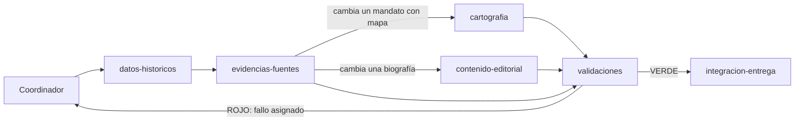

# V5.28 · Revisión de código, estructura y subagentes

Revisión completa del repositorio en tres fases sobre `main` en `d65f8ca`, después de la V5.27:

1. código innecesario: qué se ha eliminado y qué conviene simplificar;
2. estructura de carpetas propuesta y plan de migración;
3. arquitectura de subagentes especializados para el flujo de trabajo del proyecto.

La versión no cambia datos históricos, cartografía ni textos visibles. La regresión V5 (datos, mosaicos anuales y fichas públicas) termina con 0 diferencias.

## Método

- **Grafo de Graphify** del commit `d65f8ca`: 2.442 nodos, 6.629 aristas y 122 comunidades. Antes de borrar un símbolo se comprobó que tenía 0 referencias y 0 llamadas (`graphify_references`, `graphify_callers`). `graphify_file_neighbors` y `graphify_rank_files` sirvieron para medir el alcance de los módulos centrales. Por ejemplo, `src/Territorios.jsx` tiene 42 archivos vecinos.
- **Recorrido del AST** de los 393 módulos JavaScript con el parser Oxc que ya incluye Vite (`rolldown/utils`):
  - exports que ningún otro archivo menciona;
  - identificadores declarados una sola vez;
  - cuerpos de función idénticos entre archivos;
  - archivos de `src/` que la aplicación no alcanza desde `src/main.jsx`, `src/public/ssg-entry.jsx` o el mapa completo.
- **`git grep`** para lo que no se ve en el grafo:
  - importaciones dinámicas con plantilla, como los pasos de `scripts/research/authority-review/run.mjs`;
  - rutas dentro de HTML;
  - lecturas con `readFileSync` y `new URL(…, import.meta.url)`;
  - archivos servidos desde `public/`;
  - nombres con tilde o eñe (`idsDeGobiernoEnAño`), que las búsquedas con `\w` no encuentran.

## Fase 1 · Código innecesario

### Eliminado en esta versión

| Elemento | Motivo | Verificación |
| --- | --- | --- |
| Laboratorio de renderizado: `src/lab/` (4 archivos), su ruta en `App.jsx`, dos reescrituras de `vercel.json` y `tests/renderer-lab-v36.test.mjs` | Experimento de la V3.6 (HTML + SVG frente a Canvas 2D) cerrado sin migración. La página no tenía enlaces y no estaba en el índice | Solo lo importaba su test. Commit propio, revertible con `git revert` |
| `src/components/BioDiscovery.css` | Su `import` se quitó en septiembre; las reglas `.bio-discover` viven en `App.css` | Ningún archivo lo importa |
| `src/evidence/entities.js` (`buildEntityIndex`, `entityId`, `ENTITY_KINDS`) | Ni la aplicación ni los scripts lo usaban; solo un test | El test conserva sus asertos de cobertura |
| `src/public/EnglishLanding.jsx` | Alias de una línea de `EnglishPage.jsx` | `App.jsx` y `Explorer.jsx` importan la página directamente |
| Exports sin importadores: `Collapsible` (`ExplorerPrimitives.jsx`), `RAMA_A_PRINCIPAL` y `sonAmantes` (`model.js`), `SUPPORTED_LOCALES`, `LOCALES` y una copia de `ROUTE_SEGMENTS` (`i18n.jsx`) | Código muerto. `model.js` tiene su propio `ROUTE_SEGMENTS` | 0 referencias en el grafo y en `git grep` |
| `IMPERIAL_FRAME_SOURCES` (`imperialFrame.js`) | Export sin uso | Las cuatro URL pasan a un comentario para conservar la procedencia |
| Re-exportaciones sin consumidores: `FILTER_REGIONS` en `atlasFilters.js` y la geometría en `treeLayout.js` | Nadie importaba esos nombres a través de esos archivos | Comprobado import a import |
| Modelo de vista del Atlas: 67 de sus 221 campos | `Explorer.jsx` los pasaba y ni `ExplorerView.jsx` ni `AtlasTimeline.jsx` los leían | Recuento de usos en las dos vistas |
| Paneles redimensionables (`ajustarAnchoPanel`, `restablecerAnchoPanel`, `comenzarResizeLateral`, `comenzarResizeArbolMapa`, los estados `panelWidths` y `treeMapSplit`, sus refs y `limitarNumero`) | La V5.20 quitó los tiradores de la interfaz y la lógica quedó sin uso | Sin lectores tras el punto anterior |
| `alternarVista`, `hayFiltros` y `totalEventosTimeline` | Mismo caso | Sin lectores |
| Variables locales sin uso: `TREE_COLUMN_STEP` (generador), `charlesNetherlands` (`reviewRecords.js`), `gobiernosDe`, `byId` y `ent` (revisión bibliográfica), dos constantes en tests | Declaradas y nunca leídas | Identificador con una sola aparición en su archivo |
| `import React` por defecto en 44 archivos | El JSX usa el runtime automático (Vite 8/Oxc y `tests/jsx-loader.mjs`) | Se conserva donde se usa `React.Suspense`, `React.memo`, etc. |
| Dependencia `@vitejs/plugin-react` | `vite.config.js` nunca la ha cargado | Build y tests sin ella |

En total, la fase 1 retira 8 archivos y 790 líneas, con 93 añadidas: unas 700 líneas netas menos.

### Segunda pasada: simplificaciones aplicadas

La primera entrega dejó once propuestas abiertas. Se han aplicado todas salvo S10.

| # | Elemento | Qué se ha hecho | Verificación |
| --- | --- | --- | --- |
| S1 | `scripts/generate/generate-tree-base.mjs` | Ya no copia el diseño del árbol: importa `buildRows`, `createPartnerUnitBlueprint`, `orderPartnerComponent`, `orderPathIds`, `pavaNonDecreasing` y las constantes `TREE_*` de `src/domain/genealogy/treeLayout.js`, y las relaciones (`BY_ID`, `listaConyuges`, `mediana`…) de `relations.js`. Conserva su propio `computeGenerations`/`computeTreeLayout`, que difieren a propósito de los del navegador. Pasa de 1.232 a 604 líneas | `src/generated/treeBase.json` idéntico byte a byte |
| S2 | `Explorer.jsx` y `ExplorerView.jsx` | Paso M9 (más abajo) | Capturas idénticas y CSS compilado idéntico |
| S3 | `.jsx` sin JSX | `personas`, `historias` e `i18n` pasan a `.js` (paso M5). Desaparece el truco de data-URL (`importJsxData`) de 4 generadores, 5 auditorías y 3 tests | Salidas generadas idénticas |
| S4 | CSS por versión | Paso M10 | CSS compilado y capturas |
| S5 | `src/evidence/corridorReviewData.js` | Sigue versionado, porque los tests lo leen y la CI los ejecuta antes del build. Lo genera ahora `scripts/generate/generate-corridor-reviews.mjs` (dentro de `npm run generate`), en lugar de ser un efecto secundario de `generate-tree-base.mjs`, y solo escribe si cambia. `tests/corridor-reviews.test.mjs` falla si no coincide con `buildCorridorReviews(PERSONAS)`. Calcularlo en el navegador obligaría a la ficha de persona a descargar `personas.js` entero | Test nuevo en verde |
| S6 | `scripts/research/authority-review/` | Pasos con nombre propio: `wikipedia-titles`, `sparql-names`, `wikidata-search`, `matched-claims` y `government-keywords`. `http.mjs` reúne `UA`, `sleep`, `getJSON` con reintentos, `year`, `ids` y `entityRecord`, antes copiados en cinco pasos | Sintaxis y prueba de `entityRecord`. La ejecución completa necesita red y la caché, que no está en el repositorio |
| S7 | 56 exports usados solo en su archivo | Se quita la palabra `export`. Dos funciones resultaron muertas y se borran: `añoReferenciaTerritorial` (`reigns.js`) y `pct` (`timelineUtils.js`) | Recorrido del AST, incluidos los archivos nuevos |
| S8 | Funciones homónimas o duplicadas | `localeDesdePath` existe una sola vez, en `src/app/i18n.js`: la de `atlasRoutes.js` habría metido los datos del Atlas en el chunk principal. `conyugesDe` de `desafioEngine.js` pasa a llamarse `conyugesConInversos`. `governmentKey` de `europeTimeline.js` pasa a `governmentIdentity`. Las cuatro copias del hash FNV-1a (desafío, Dinastle, repaso y colores territoriales) usan `src/utils/hash.js` | El hash da el mismo valor en 8.788 entradas reales (territorios, IDs, nombres). Las variantes solo diferían en caracteres fuera del BMP, que no aparecen en ninguna entrada |
| S9 | `MapChart_Map.svg` | Pasa a `data/cartography/` (paso M7) | Tests y auditorías |
| S10 | `public/EADE.png` | **No se toca**, por decisión del propietario | — |
| S11 | `sharp` | Se conserva y se versiona su uso: `scripts/assets/portrait-variants.mjs` genera las variantes WebP de un retrato con la regla que siguen los 148 actuales (96, 192 y 384 px menores que el original, más el original con un máximo de 768) y las registra en `src/data/imageVariants.js` | Con originales de prueba reproduce exactamente las entradas existentes |

También se retiran tres imports que ya no se usaban en `Explorer.jsx` (`listaReinados`, `siglo`, `finEvento`) y 278 reglas y 58 selectores CSS sin elementos (paso M10).

## Fase 2 · Estructura

### Diagnóstico

- **Producción dependía de `prototypes/`.** `src/data/europePanorama.js`, la regresión V5, seis auditorías y 19 tests importaban `prototypes/euv-locations/atlas-mosaic.js`, que el catálogo clasificaba como «laboratorio». Corregido en esta versión (paso M1).
- **`src/data/` mezcla responsabilidades.** Reúne 53 módulos: datos fuente (`territorios.js`), cartografía (rutas, identidades, mosaicos), presentación (`governmentPresentation.js`) y lógica que solo usaban las auditorías. Esto último se ha trasladado en esta versión (paso M2).
- **Raíz de `src/` sin criterio.** Datos de 1 MB (`personas.jsx`, `historiaData.jsx`) conviven con componentes (`MapaEuropa.jsx`, `Explorer.jsx`) y utilidades (`mapViewport.js`, `monitoring.js`).
- **Nombres por versión en lugar de por tema.** Ocurre en tests (`*-v213.test.mjs`), contenido (`personas/minibiografias-v524.js`) y CSS.
- **`docs/` mezcla dos tipos de documento.** Unos 80 informes `V*.md` en la raíz conviven con las guías vigentes.

### Estructura resultante

Se han aplicado los once pasos del plan. Entre paréntesis, el número de archivos versionados.

```
src/
  app/            (6)  Arranque, enrutado y configuración: main.jsx, App.jsx, routing.js, siteConfig.js, i18n.js, monitoring.js
  data/           (6)  Base de datos editable: personas.js, historias.js, territorios.js, imagenesPersonas.js, imageVariants.js, dynastyAliases.js
  content/        (55) Contenido editorial: biografías, dinastías, territorios, sucesiones, coronas, fuentes
  evidence/       (25) Revisiones por afirmación, claims.js y reviewRecords.js
  domain/         (22) Lógica pura, sin React ni DOM
    genealogy/         relations.js, dynasties.js, relationshipGraph.js, personAccessors.js, dynastyModel.js,
                       dynastyBranchSelection.js, treeLayout.js, treeGeometry.js
    government/        reigns.js, authorityKind.js, crowns.js, sucesion.js, successionHistory.js, governmentPresentation.js
    filters/           atlasFilters.js, filterRegions.js, territoryFilters.js
    people/            personLabels.js, personPresentation.js
    time/              europeYear.js, europeTimeline.js, documentaryDates.js
  cartography/    (49) kingdomMaps.js, atlasMosaic.js, locationMosaic.js, locationMapPilot.js, territorialNames.js,
                       territorialIdentity.js, politicalMapIndex.js, mapAuthorities.js… y regions/ (28): *Routes.js,
                       *RouteData.json, *Territories.js
  features/       (104) Interfaz por función, cada una con su CSS
    atlas/             Explorer.jsx (modelo de vista y hooks use*.js), ExplorerView.jsx, view/ (8 subcomponentes),
                       MapaEuropa.jsx, cronología, Europa en el año, búsqueda, rutas (atlasRoutes.js) y constantes (atlasModel.js)
    public/            Portada (HomePage.jsx), fichas (PublicSite.jsx), piezas comunes (publicShared.jsx), SSG
    stories/  desafio/  connections/  english/  embed/  settings/
  components/     (11) Piezas de dominio compartidas y cabecera/pie del sitio
  ui/             (8)  Primitivas sin dominio
  utils/          (3)  loadAsset.js, responsiveImage.js, hash.js
  styles/         (3)  app.css, index.css, theme.css
  generated/           Salida de scripts/generate (ignorada en Git)
data/cartography/ (50) Fuentes, revisiones e inventarios aceptados y MapChart_Map.svg
labs/cartography/ (8)  Visores de revisión, capturas y README
scripts/               generate/, audits/ (+ lib/), cartography/, research/, schema/, lib/, assets/
docs/                  Guías vigentes; versiones/ (67 informes V*.md), reports/, archive/
.claude/agents/        Subagentes del proyecto (fase 3)
```

Reglas de capa, comprobadas con el grafo de importaciones:

- `src/data`, `src/domain` y `src/cartography` no importan `src/features` ni `src/app`, salvo `i18n.js`. Los comparten la aplicación, los generadores y las auditorías, y eso eliminó la copia del diseño del árbol (S1).
- `src/features/*` agrupa por funcionalidad lo que estaba repartido entre la raíz de `src/`, `src/explorer` y `src/public`.
- `data/cartography` y `labs/cartography` separan los datos aceptados de los visores, sin la palabra «prototipo».
- Ningún módulo que lean los tests depende de `src/generated/`, porque la CI ejecuta los tests antes del build. Por eso `src/evidence/corridorReviewData.js` sigue versionado, con su generador en `npm run generate` y un test que exige que coincida con su fuente.
- `tests/page-weight.test.mjs` impide que la portada, `App.jsx` o las fichas vuelvan a importar estáticamente lo que no necesitan (fichas, Atlas, evidencias, piloto del mapa o rutas regionales).

### Correspondencia de rutas

Para ramas abiertas que toquen archivos movidos:

| Antes | Ahora |
| --- | --- |
| `src/personas.jsx`, `src/historiaData.jsx` | `src/data/personas.js`, `src/data/historias.js` |
| `src/i18n.jsx`, `src/main.jsx`, `src/App.jsx`, `src/routing.js`, `src/siteConfig.js`, `src/monitoring.js` | `src/app/` (con `i18n.js`) |
| `src/Territorios.jsx` | `src/cartography/kingdomMaps.js` (IDs, versiones y colores de reinos), `src/domain/government/reigns.js` (`listaReinados`, `reinadosActivos`…) y `src/domain/filters/territoryFilters.js` (`TERRITORIOS_DESTACADOS`, `TERRITORIOS_SUB`) |
| `src/explorer/model.js` | `src/domain/genealogy/relations.js` y `dynasties.js`, y `src/features/atlas/atlasRoutes.js` y `atlasModel.js` |
| `src/data/*Routes.js`, `*RouteData.json`, `*Territories.js`, `atlasChronology*` | `src/cartography/regions/` |
| Resto de módulos de mapa de `src/data/` | `src/cartography/` |
| Lógica de `src/data/` y `src/explorer/` sin React | `src/domain/<área>/` |
| `src/Explorer.jsx`, `src/explorer/*`, `src/MapaEuropa.jsx`, `src/mapViewport.js` | `src/features/atlas/` |
| `src/public/`, `src/stories/`, `src/desafio/`, `src/connections/`, `src/english/`, `src/embed/`, `src/settings/` | `src/features/…` |
| `src/evidence/EvidencePanel.jsx`, `CoverageDialog.jsx`, `evidence.css` | `src/components/` |
| `src/App.css`; `src/explorer/v39.css` + `v40.css`; `src/styles/v518.css`–`v521.css` | `src/styles/app.css`; `src/features/atlas/atlas-controls.css`; `src/features/atlas/atlas-refinements.css` |
| `prototypes/euv-locations/*.json`, `src/MapChart_Map.svg` | `data/cartography/` |
| `prototypes/euv-locations/*.html`, `*.png` | `labs/cartography/` |
| `docs/V*.md` | `docs/versiones/V*.md` |
| `scripts/research/authority-review/match1`, `match4`, `match5`, `ensure`, `govkw` | `wikipedia-titles`, `sparql-names`, `wikidata-search`, `matched-claims`, `government-keywords` |

### Plan de migración por pasos

Cada paso se aplicó y verificó por separado: tests, salidas generadas idénticas y, en los visuales, capturas y CSS compilado.

| Paso | Cambio | Estado | Verificación |
| --- | --- | --- | --- |
| M1 | Mosaico del mapa fuera de `prototypes/` | **Aplicado** | Regresión de mosaicos 1200–1800 |
| M2 | Lógica de auditoría a `scripts/audits/lib/` | **Aplicado** | Ningún módulo de la aplicación la importaba |
| M3 | `desafioEngine.jsx` → `.js` | **Aplicado** | 3 importadores |
| M4 | Nota `next updates` archivada | **Aplicado** | — |
| M5 | S3 y S1: datos en `.js` y generador sin copias del árbol | **Aplicado** | `treeBase.json`, `home.json` y metadatos públicos idénticos |
| M6 | `src/cartography/` y `src/cartography/regions/` | **Aplicado** | 223 de 237 módulos se importan en Node (los 14 restantes usan JSON o `?url` de Vite) |
| M7 | `prototypes/euv-locations/` → `data/cartography/` + `labs/cartography/`: Python, `project-paths.mjs`, catálogo, CI, `vite.config.js` y `vercel.json` | **Aplicado** | `audit:artifacts`, `cartography:check`, `/es/mapa-completo` |
| M8 | `src/app/`, `src/data/`, `src/domain/`, `src/features/`, con reescritura automática de importaciones | **Aplicado** | Sin alias de importación: las rutas relativas se reescribieron con el AST y un alias obligaría a duplicar la resolución en `tests/jsx-loader.mjs`, los scripts de Node y Graphify |
| M9 | S2: `ExplorerView.jsx` se divide en 8 subcomponentes (`view/AtlasToolbar`, `AtlasTopbar`, `CompareBar`, `FocusBar`, `AtlasFiltersPanel`, `AtlasTreeStage`, `AtlasMapStage`, `AtlasBiographyPanel`) y pasa de 1.150 a 283 líneas. `Explorer.jsx` delega en `useAtlasLayout`, `useFavorites`, `useShareStatus` y `useDragScroll` (de 1.630 a 1.504 líneas) | **Aplicado** | CSS compilado idéntico byte a byte. Capturas del Atlas con 0 píxeles distintos en los 4 modos. `ExplorerView` conserva imports sin nombre de los componentes con estilos para no alterar la cascada |
| M10 | S4: 278 reglas CSS sin elementos retiradas. `v39`+`v40` → `atlas-controls.css`, `v518`–`v521` → `atlas-refinements.css`, en el mismo punto de la cascada | **Aplicado** | Capturas: ≤ 0,032 % de diferencia, igual que entre dos builds de `main` |
| M11 | `docs/V*.md` → `docs/versiones/` con 41 archivos de enlaces reescritos | **Aplicado** | 0 enlaces relativos rotos, igual que en `main`. Se arreglaron 7 enlaces a `prototypes/` que había roto M7. Los tests siguen planos en `tests/`: el comando de verificación (`tests/*.test.mjs`) no recorre subcarpetas |

## Fase 3 · Arquitectura de subagentes

El flujo real del proyecto tiene seis tipos de trabajo, y cada uno con su contrato y sus auditorías:

- datos históricos;
- evidencias;
- cartografía;
- contenido editorial;
- interfaz;
- entrega con regresión.

Los subagentes siguen esas costuras. Las definiciones están en `.claude/agents/*.md`: el cuerpo de cada archivo es su prompt de sistema completo, y Claude Code las carga al abrir el repositorio.

### Agentes

| Agente | Rol | Escribe en | Comprobaciones propias |
| --- | --- | --- | --- |
| [`datos-historicos`](../../.claude/agents/datos-historicos.md) | Base de datos: personas, fechas, parentescos, mandatos, territorios, sucesiones, coronas | `src/data/personas.js`, `src/data/territorios.js`, `src/content/sucesiones/`, `src/content/coronas/` | `audit:data-contract`, `audit-personas`, `audit-territorios`, sucesiones, coronas, dinastías |
| [`evidencias-fuentes`](../../.claude/agents/evidencias-fuentes.md) | Fuentes y certeza de cada afirmación; revisión con fichas GND | `src/evidence/*.js`, `src/content/sources*.js`, `scripts/research/` | Tests de evidencias, contrato |
| [`cartografia`](../../.claude/agents/cartografia.md) | Superficies anuales, rutas, identidades y colores; Python | `data/cartography/`, `labs/cartography/`, `scripts/cartography/`, `src/cartography/` | `audit:artifacts`, auditorías de continuidad y celdas, `cartography:check` |
| [`contenido-editorial`](../../.claude/agents/contenido-editorial.md) | Biografías, historias, dinastías, territorios, retratos, edición inglesa | `src/content/` (salvo fuentes y sucesiones), `src/data/historias.js`, `public/personas-img/`, `scripts/assets/` | `npm run generate`, tests de contenido |
| [`interfaz`](../../.claude/agents/interfaz.md) | React, CSS, accesibilidad, SSG e hidratación | `src/features/`, `src/components/`, `src/ui/`, `src/styles/`, `routing.js`, `index.html`, `vercel.json` | Tests de interfaz, verificación en el navegador, muestra SSG |
| [`validaciones`](../../.claude/agents/validaciones.md) | Ejecuta contratos, auditorías, tests, build y regresión; emite el dictamen | Solo `.cache/` | Todas; asigna cada fallo a su responsable |
| [`calidad-codigo`](../../.claude/agents/calidad-codigo.md) | Código muerto, duplicados, estilo y estructura; sin cambios de comportamiento | Cualquier ruta, coordinada con su propietario | Graphify + `git grep` antes de borrar; tests afectados |
| [`integracion-entrega`](../../.claude/agents/integracion-entrega.md) | Versión, informe, base de regresión justificada, commits y PR | `package.json`, `docs/versiones/V*.md`, `docs/releases.md`, `tests/baselines/` (solo vía npm) | Exige un dictamen VERDE |

### Instrucciones clave de cada prompt

- **datos-historicos.** Conserva una persona por línea. No cambia un dato sin obra, URL y pasaje. Busca duplicados antes de crear. Los IDs son estables. Lee el contrato (`data-model.md`, `contributing-people.md`) al empezar.
- **evidencias-fuentes.** Usa solo las certezas `documented`, `approximate`, `disputed`, `inferred` y `pending`. Nunca inventa fuentes ni páginas. Prefiere obras de referencia específicas, y la fecha de Deutsche Biographie no cuenta como independiente de GND. Propone las correcciones al agente de datos en lugar de aplicarlas.
- **cartografia.** Una coincidencia espacial no prueba dominio. Regenera en `.cache/cartography/work` con `EADE_MAP_DATA_DIR` y cataloga cada archivo nuevo. Mide el alcance con Graphify antes de tocar módulos centrales. Describe año y celda de cada diferencia de regresión esperada.
- **contenido-editorial.** No añade hechos sin fuente. Fechas y títulos coinciden con `src/data/personas.js`; una discrepancia la corrige el agente de datos. Cada retrato lleva licencia y origen.
- **interfaz.** Runtime JSX automático. El primer render debe coincidir con el HTML prerenderizado. Mantiene `strictExecutionOrder`. El modelo de vista se cambia en los dos lados. Verifica en el navegador a 375 px y en ambos temas.
- **validaciones.** Ejecuta en orden contrato, seguridad, `audit:build`, tests y build. No edita nada y nunca escribe bases. Asigna cada fallo según la tabla de rutas.
- **calidad-codigo.** Confirma con el grafo y con `grep` (clases Unicode). Conoce los puntos ciegos: imports con plantilla, HTML, `readFileSync`, `public/`. Hace commits pequeños y revertibles.
- **integracion-entrega.** Sin dictamen VERDE no hay PR. La base de regresión solo cambia con un motivo que coincida con los informes. Aplica las convenciones de commit y de PR, y nunca hace `stash`, `reset` ni cambia de rama ajena.

### Protocolo de comunicación

1. **Coordinador.** La sesión principal recibe la petición y escribe la ficha `.cache/agentes/<tarea>/00-encargo.md`:
   - objetivo;
   - rutas permitidas;
   - criterio de hecho;
   - agentes y orden.

   `.cache/` está ignorado por Git.
2. **Informes de entrega.** Cada agente termina escribiendo `NN-<agente>.md` en esa carpeta, con el formato fijo de su prompt (estado, cambios con `archivo:línea`, fuentes, comandos con su resultado, a quién afecta y pendientes). Devuelve el mismo texto como respuesta. El siguiente agente lee la ficha y los informes anteriores, no la conversación.
3. **Propiedad de rutas.** Cada ruta tiene un único agente escritor (tabla anterior). Dos agentes trabajan en paralelo solo si sus rutas no se cruzan, y los que escriben a la vez usan worktrees distintos.
4. **Dictamen y bucle de corrección.** `validaciones` devuelve VERDE o ROJO con cada fallo asignado. El coordinador reenvía el extracto al responsable. Tras dos vueltas en rojo sobre el mismo fallo, la decisión pasa al usuario.
5. **Base de regresión.** Una diferencia intencionada viaja en el informe del agente que la causa (persona, año, celda). Solo `integracion-entrega` la acepta, con `npm run baseline:regression -- --reason` y aprobación del usuario.
6. **Grafo compartido.** Antes de tocar un archivo central, el agente consulta Graphify (`graphify_file_neighbors`, `graphify_impact`) y anota en su informe los tests elegidos con `graphify_tests_for`. `validaciones` ejecuta después la batería completa.

### Flujos habituales



| Tarea | Secuencia | En paralelo |
| --- | --- | --- |
| Corregir una persona, fecha o mandato | datos → evidencias → (cartografía) → (editorial) → validaciones → integración | cartografía ∥ editorial |
| Ampliar una región del mapa | cartografía (+ evidencias para las citas) → datos (gobiernos nuevos) → validaciones → integración | evidencias ∥ cartografía |
| Biografías, historias o retratos | evidencias → editorial → validaciones → integración | Varios editoriales por archivos distintos |
| Función de interfaz | interfaz → calidad → validaciones → integración | |
| Limpieza o refactor (como esta versión) | calidad → validaciones → integración | Un paso del plan por agente y worktree |

## Rendimiento y peso de las páginas

### Cambios que afectan a la carga

| # | Cambio | Efecto |
| --- | --- | --- |
| P1 | `App.jsx` importa solo la portada (`HomePage.jsx`); fichas de persona, índices, páginas informativas y la edición inglesa se cargan con `lazy()`. Dinastía, territorio e historia usan `publicShared.jsx` en lugar de `PublicSite.jsx` | La portada deja de descargar fichas, evidencias y cartografía, y las fichas ligeras dejan de descargar evidencias y cartografía |
| P2 | `territorialNames.js` reúne sin rutas regionales los alias editoriales, la identidad de un territorio de mandato y las etiquetas fechadas; `governmentPresentation` lo usa en lugar de `territorialIdentity.js`. `authorityKind` sale de `mapAuthorities.js`. Ningún territorio de mandato depende de una ruta regional y `tests/territorial-names.test.mjs` lo exige | La ficha de persona deja de descargar el piloto del mapa y las rutas regionales (unos 140 KB brotli), sin añadir nada al Atlas |
| M10 | 278 reglas CSS sin elementos retiradas | CSS total de 49,6 a 44,9 KB brotli |

`tests/page-weight.test.mjs` fija los dos cortes: falla si una de esas entradas vuelve a alcanzar lo que no necesita.

### Peso inicial (HTML prerenderizado + JS y CSS enlazados, brotli calidad 11)

| Página | JS `main` | JS V5.28 | CSS `main` → V5.28 |
| --- | --- | --- | --- |
| Ficha de persona (Carlos V) | 563 KB (12 archivos) | 278 KB (24), −51 % | 14,9 → 11,4 KB |
| Ficha de dinastía (Habsburgo) | 567 KB | 82 KB, −86 % | 15,4 → 10,1 KB |
| Ficha de territorio (Castilla) | 567 KB | 97 KB, −83 % | 15,6 → 10,9 KB |
| Historia | 566 KB | 81 KB, −86 % | 17,3 → 11,9 KB |
| Portada inglesa | 567 KB | 297 KB, −48 % | 17,3 → 17,6 KB |

El JS de todo el sitio sube de 737 a 762 KB (34 → 45 archivos), porque los chunks pequeños comprimen peor por separado. La portada de la aplicación (`index.html`, que precarga 55 KB) no cambia: el ahorro está en lo que carga después.

### Velocidad de carga

**Método.**
- Se sirven a la vez los dos builds de producción (`main` en `d65f8ca` y esta rama) en local, con brotli de calidad 11 y las reescrituras de `vercel.json`.
- Se miden con Chrome sin interfaz y el protocolo DevTools, con la caché desactivada. Las cargas de los dos builds se alternan en cada página, para que la actividad del equipo afecte por igual a ambos, y cada valor es la mediana de 5 cargas.
- Perfiles:
  - móvil: Slow 4G (150 ms de latencia, 1,6 Mbit/s), CPU 4× más lenta y pantalla de 412 px;
  - escritorio: sin limitación, a 1366 × 900.
- Métricas:
  - FCP y LCP: primer contenido y mayor elemento pintados;
  - Listo: aparece el lienzo del árbol o el panorama de Europa;
  - TBT: suma de lo que cada tarea larga pasa de 50 ms;
  - CLS: desplazamiento acumulado del diseño;
  - JS y transferido: KB descargados.

**Móvil (Slow 4G, CPU 4×)**

| Página | FCP | LCP | Listo | TBT | CLS | JS (KB) | Transferido (KB) |
| --- | --- | --- | --- | --- | --- | --- | --- |
| Portada | 4,3 s → 1,6 s | 4,3 s → 1,6 s | – → – | 504 ms → 76 ms | 0 → 0 | 577 → 104 (−82 %) | 1380 → 904 (−34 %) |
| Atlas (Carlos V) | 4,1 s → 1,4 s | 7,1 s → 7,2 s | 6,9 s → 7,1 s | 3,8 s → 4,1 s | 0 → 0 | 694 → 727 (+5 %) | 877 → 907 (+3 %) |
| Ficha de persona | 804 ms → 840 ms | 804 ms → 840 ms | – → – | 606 ms → 225 ms | 0 → 0 | 566 → 283 (−50 %) | 636 → 350 (−45 %) |
| Ficha de dinastía | 824 ms → 792 ms | 824 ms → 792 ms | – → – | 567 ms → 119 ms | 0 → 0 | 569 → 85 (−85 %) | 637 → 147 (−77 %) |
| Historia | 780 ms → 768 ms | 780 ms → 768 ms | – → – | 441 ms → 0 ms | 0.293 → 0 | 568 → 84 (−85 %) | 599 → 109 (−82 %) |
| Europa en 1500 | 4,2 s → 1,4 s | 8,1 s → 8,2 s | 7,8 s → 7,9 s | 2,6 s → 2,4 s | 0.358 → 0.358 | 699 → 732 (+5 %) | 853 → 884 (+4 %) |
| Mapa completo | 260 ms → 252 ms | 260 ms → 252 ms | – → – | 445 ms → 450 ms | 0 → 0 | 384 → 409 (+7 %) | 387 → 413 (+7 %) |

**Escritorio (sin limitación)**

| Página | FCP | LCP | Listo | TBT | CLS | JS (KB) | Transferido (KB) |
| --- | --- | --- | --- | --- | --- | --- | --- |
| Portada | 320 ms → 164 ms | 320 ms → 164 ms | – → – | 72 ms → 0 ms | 0 → 0 | 577 → 104 (−82 %) | 1036 → 559 (−46 %) |
| Atlas (Carlos V) | 252 ms → 112 ms | 940 ms → 960 ms | 836 ms → 843 ms | 695 ms → 766 ms | 0.003 → 0.003 | 699 → 733 (+5 %) | 2317 → 2348 (+1 %) |
| Ficha de persona | 124 ms → 136 ms | 124 ms → 136 ms | – → – | 77 ms → 0 ms | 0 → 0 | 566 → 283 (−50 %) | 635 → 349 (−45 %) |
| Ficha de dinastía | 132 ms → 128 ms | 132 ms → 128 ms | – → – | 78 ms → 0 ms | 0 → 0 | 569 → 85 (−85 %) | 652 → 162 (−75 %) |
| Historia | 100 ms → 116 ms | 100 ms → 116 ms | – → – | 69 ms → 0 ms | 0 → 0 | 568 → 84 (−85 %) | 598 → 108 (−82 %) |
| Europa en 1500 | 232 ms → 96 ms | 1,3 s → 1,2 s | 1,2 s → 1,1 s | 638 ms → 587 ms | 0.207 → 0.207 | 699 → 732 (+5 %) | 2296 → 2326 (+1 %) |
| Mapa completo | 48 ms → 60 ms | 48 ms → 60 ms | – → – | 367 ms → 391 ms | 0.326 → 0.326 | 384 → 409 (+7 %) | 1818 → 1844 (+1 %) |

**Lectura.**

- **Portada.** En móvil, el primer contenido y el mayor elemento pasan de 4,3 a 1,6 s, y el bloqueo del hilo principal de 504 a 76 ms.
- **Fichas.** Ya pintaban pronto porque llegan prerenderizadas. Ahora descargan entre un 45 y un 82 % menos y apenas bloquean el hilo principal (TBT de 0 a 225 ms frente a 441–606 ms). La historia deja de desplazar el diseño en móvil (CLS 0,293 → 0).
- **Atlas y Europa.** Pintan antes (FCP en móvil de 4,1–4,2 s a 1,4 s), porque el armazón ya no espera al código de las fichas. Quedan listos en el mismo tiempo que en `main`: +0,1–0,2 s en móvil y lo mismo en escritorio. Su JS crece un 5 % (unos 33 KB): el reparto en más chunks comprime peor.
- **Mapa completo** (laboratorio). Mismos tiempos; +25 KB de JS por el mismo motivo.

### Mejoras pendientes

| Mejora | Medida actual | Propuesta |
| --- | --- | --- |
| Evidencias de la ficha de persona | Las revisiones de todas las personas (unos 140 KB brotli) viajan a cada ficha | Generar en el build un JSON de evidencias por persona, como `personas-meta/` |
| Desplazamiento de diseño | CLS 0,358 (Europa en móvil), 0,207 (Europa en escritorio), 0,326 (mapa completo) | Reservar el alto del panorama y del mapa antes de que lleguen los datos |
| Bloqueo del Atlas en móvil | TBT de unos 4 s con CPU 4× | Trocear la preparación del árbol y del mosaico en tareas cortas o en un worker |
| Chunks del Atlas | +33 KB por la fragmentación | Agrupar con `advancedChunks` los módulos que el Atlas siempre carga juntos |


## Comprobaciones de esta versión

| Comprobación | Resultado |
| --- | --- |
| `node --import ./tests/jsx-loader.mjs --test tests/*.test.mjs` | **527/527**. Respecto a los 522 de la primera entrega, se añaden la sincronía de corredores, la identidad de los territorios de mandato y tres tests de peso por página |
| `npm run build` | Auditorías del prebuild en verde. SSG: 4.128 fichas sin errores. Regresión V5 de datos (601 años) y pública (4.128 fichas): **0 diferencias**. La base no se ha tocado |
| Salidas generadas | `treeBase.json`, `home.json`, los metadatos públicos y `corridorReviewData.js` idénticos byte a byte. Solo cambia la marca de tiempo de `siteMeta.json` |
| CSS compilado | Idéntico en sus 16 archivos antes y después de dividir el Atlas y de P2 |
| Capturas deterministas | 11 páginas × escritorio/móvil × claro/oscuro, con fecha y azar fijos y movimiento reducido; el Atlas espera a que el mapa termine de cargar. Diferencia máxima con `main`: 0,032 %, el suavizado de las teselas SVG de Europa en 1500, igual que entre dos builds de `main`. El Atlas con Carlos V sale idéntico (0 píxeles). Ningún error de JavaScript |
| Interacción del Atlas en el navegador | Pestañas de la biografía, secciones de filtros, favoritos, arrastre del árbol, compartir (enlace copiado y aviso que desaparece), búsqueda y ocultar paneles, con su persistencia: igual que en `main`. La única diferencia es que el estado guardado ya no incluye `panelWidths` ni `treeMapSplit`, retirados en la fase 1 |
| Variables de entorno | `VITE_SITE_URL` y `VITE_CONTACT_EMAIL` llegan al build; no queda ningún `import.meta.env` sin sustituir |
| Enlaces de la documentación | 0 enlaces relativos rotos |

Hay un test intermitente previo: `learning-ui-v215` («Retratos…») falló una vez en la batería completa. También falla en `main` (1 de 40 ejecuciones aisladas), porque elige un retrato al azar y 8 de los 148 retratados tienen homónimos. Queda como tarea aparte.
